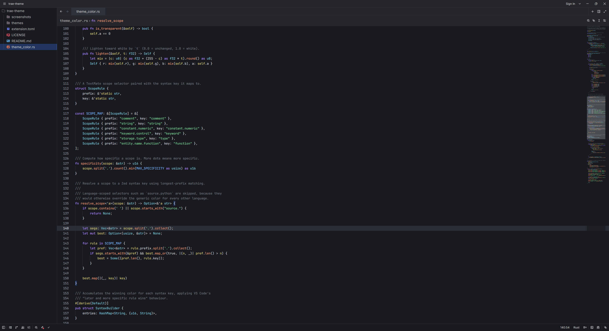
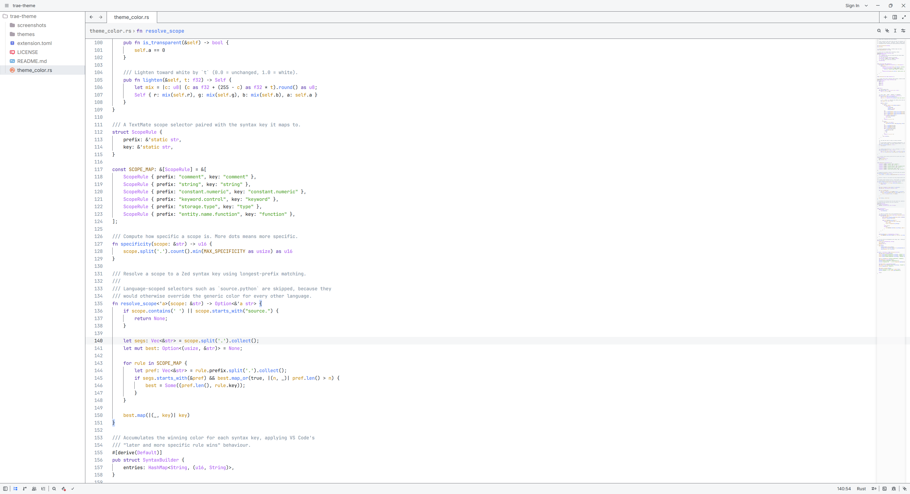
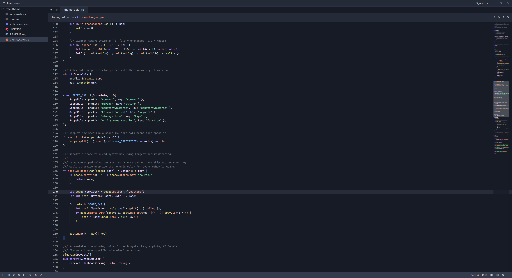

# Trae Theme for Zed

[](https://zed.dev/extensions/trae-theme)

Color themes for [Zed](https://zed.dev)

## Screenshots

### Dark



### Light



### Deep Blue



## Themes

| Theme              | Appearance |
| ------------------ | ---------- |
| **Trae Dark**      | dark       |
| **Trae Light**     | light      |
| **Trae Deep Blue** | dark       |

## Usage

Open the Extensions page in Zed (<kbd>ctrl</kbd>+<kbd>shift</kbd>+<kbd>x</kbd>),
search for **Trae**, and click Install. Then pick a theme with the theme
selector:

```
theme selector: Toggle
```

To auto-switch between light and dark based on the system appearance, open your
Zed user `settings.json` and add:

```json
{
  "theme": {
    "mode": "system",
    "light": "Trae Light",
    "dark": "Trae Dark"
  }
}
```

If you prefer Deep Blue as your dark theme:

```json
{
  "theme": {
    "mode": "system",
    "light": "Trae Light",
    "dark": "Trae Deep Blue"
  }
}
```

## Customization

Every color in these themes is derived from the original Trae palettes. If you
want to tweak something locally, you can override any theme color in your Zed
`settings.json` under `themes`.

## License

MIT — see [LICENSE](./LICENSE).
